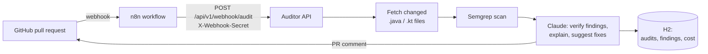

# AI Code Security Auditor

Automated security review for pull requests in Java and Kotlin projects, focused on the mistakes that AI coding assistants (Copilot, Cursor, Claude Code) tend to introduce: SQL built by string concatenation, endpoints without authorization, hardcoded secrets, missing input validation.

When a pull request is opened, the auditor fetches the changed files, runs Semgrep, asks Claude to verify and explain the findings, and posts a single Markdown report as a comment on the pull request.

**Stack:** Java 17 · Spring Boot 3.2 · Spring Security · Spring Data JPA · WebClient · H2 · Semgrep · Claude API · n8n · Docker

## How it works



1. n8n receives the GitHub event and calls the webhook with the repository, PR number, commit SHAs and the client's API key.
2. The request is accepted immediately (`202 Accepted`); the audit runs asynchronously on a bounded thread pool.
3. `GitHubService` downloads the changed Java/Kotlin files (with size and file-count limits).
4. `SemgrepService` runs the OWASP, Spring Security, Java and secrets rule sets (optional).
5. `ClaudeService` sends the code and the Semgrep results to Claude, which filters false positives and writes the report.
6. The report is posted to the PR (replacing the previous audit comment), and the audit, findings, token usage and estimated cost are stored.

## Quick start (no external services)

Requirements: Java 17+ and Maven 3.9+ (or IntelliJ IDEA, which bundles Maven).

```bash
mvn spring-boot:run
```

The default `local` profile uses an in-memory H2 database and creates a test client with the key from `DEFAULT_CLIENT_API_KEY` (or `test-api-key-12345` if it is not set). Without `CLAUDE_API_KEY` the auditor runs in demo mode and returns a sample report.

```bash
curl -X POST http://localhost:8080/api/v1/audits/test \
  -H "X-Client-Api-Key: test-api-key-12345" \
  -H "Content-Type: application/json" \
  -d '{"filename":"UserController.java","code":"String q = \"SELECT * FROM users WHERE id = \" + id;"}'
```

To get a real AI analysis, copy `.env.example` to `.env` and set `CLAUDE_API_KEY`. The application reads `.env` from the project root on startup; real environment variables take precedence.

## Full stack with Docker Compose

```bash
cp .env.example .env   # fill in all values
docker compose up -d
```

| Service | URL |
| --- | --- |
| Auditor API | http://localhost:8080 |
| n8n | http://localhost:5678 |

Both ports are bound to 127.0.0.1. Compose refuses to start if a required secret is missing.
The client used by n8n is created at startup with the key from `DEFAULT_CLIENT_API_KEY`.
More clients can be added with the admin key:

```bash
curl -X POST http://localhost:8080/api/v1/clients \
  -H "X-Admin-Api-Key: $ADMIN_API_KEY" \
  -H "Content-Type: application/json" \
  -d '{"name":"My team","email":"dev@example.com"}'
```

Audits are kept in an in-memory H2 database, so they are cleared when the application restarts.

## Running the full pipeline locally (GitHub → n8n → auditor → Telegram)

This is how the project runs on a single Windows machine without Docker: the auditor and n8n listen only on
`127.0.0.1`, and two Cloudflare quick tunnels make them reachable from GitHub and from a phone
without exposing the machine's IP address.

```
GitHub push / PR ──► tunnel ──► n8n :5678 ──► auditor :8080 ──► Claude API
                                    │                │
                                    │                └──► PR comment (GitHub API)
                                    └──► Telegram message with a signed report link ──► tunnel ──► auditor
```

### 1. Prerequisites (once)

```powershell
winget install --id EclipseAdoptium.Temurin.21.JDK   # or any Java 17+
winget install --id OpenJS.NodeJS.LTS                # for n8n (npx)
winget install --id Cloudflare.cloudflared
```

Open a new PowerShell window after installing, so the new commands are on the `PATH`.

You also need:

- a Claude API key,
- a fine-grained GitHub token limited to the audited repositories, with *Contents: Read* and
  *Pull requests: Read and write*,
- a Telegram bot token (from @BotFather) and your chat id (from @userinfobot), if you want notifications.

### 2. Configure `.env`

```powershell
Copy-Item .env.example .env
```

Fill in at least `CLAUDE_API_KEY`, `GITHUB_TOKEN`, `WEBHOOK_SECRET`, `ADMIN_API_KEY` and `DEFAULT_CLIENT_API_KEY`.
Use long random values for the last three, for example:

```powershell
[Convert]::ToHexString((1..24 | % { Get-Random -Max 256 }))
```

Write values without quotes and without spaces around `=`. Keep `H2_CONSOLE_ENABLED=false` and
`SERVER_ADDRESS=127.0.0.1`: behind a tunnel every request looks local.

### 3. Start the tunnels (two windows, keep them open)

```powershell
# window 1: auditor (report links)
cloudflared tunnel --url http://localhost:8080

# window 2: n8n (GitHub webhook)
cloudflared tunnel --url http://localhost:5678
```

Each prints an address like `https://random-words.trycloudflare.com` in a box. Quick tunnel addresses change on
every start, so repeat steps 4–6 when you restart a tunnel. A named tunnel on your own domain gives a stable address.

### 4. Start the auditor

Put the auditor tunnel address into `.env`:

```
PUBLIC_BASE_URL=https://<auditor-tunnel>.trycloudflare.com
```

Then start the application from the project root (IntelliJ: run `AiSecurityAuditorApplication`, or):

```powershell
mvn spring-boot:run
```

Check the `Configuration:` line in the startup log: every key you set must show `set`. Restart the application
after every change to `.env`.

### 5. Start n8n

```powershell
$env:N8N_LISTEN_ADDRESS = "127.0.0.1"
$env:WEBHOOK_URL = "https://<n8n-tunnel>.trycloudflare.com/"
npx n8n
```

Open http://localhost:5678 and protect the owner account with a strong password: the editor is reachable
through the tunnel too.

n8n blocks `$env` in expressions by default (`N8N_BLOCK_ENV_ACCESS_IN_NODE`), so the workflow uses fixed values:

| Node | Setting |
| --- | --- |
| HTTP Request → `POST http://localhost:8080/api/v1/webhook/audit` | Header Auth credential `X-Webhook-Secret` = `WEBHOOK_SECRET`; JSON body with `repoFullName`, `prNumber`, `baseSha`, `headSha`, `changedFiles`, `clientApiKey` = `DEFAULT_CLIENT_API_KEY` |
| HTTP Request → `GET http://localhost:8080/api/v1/audits/stats` | Authentication *None*, *Send Headers* on, `X-Client-Api-Key` = `DEFAULT_CLIENT_API_KEY` |
| Telegram | Telegram API credential with the bot token; Chat ID as a fixed number; text uses `{{ $json.latestReportUrl }}` |

Activate (publish) the workflow: production webhook URLs work only for active workflows.

### 6. Connect GitHub

In the audited repository: *Settings → Webhooks → Add webhook*

- **Payload URL:** the *Production URL* of the n8n webhook node (`https://<n8n-tunnel>.trycloudflare.com/webhook/...`)
- **Content type:** `application/json`
- **Events:** pull requests (and pushes, if the workflow handles them)

*Recent Deliveries* shows the response for each event; *Redeliver* re-sends one for testing.

### 7. Check that it works

1. Push a change to a `.java` file, or open a pull request.
2. GitHub *Recent Deliveries* shows `200`.
3. The auditor log shows `AUDIT START`, the four steps and `AUDIT DONE` followed by `Report: https://...`.
4. Telegram receives a message with a link that opens the report (also from a phone).
5. For pull requests, the report is posted as a PR comment. With `prNumber` 0 (a push without a PR) it is only stored.

### Troubleshooting

| Symptom | Cause and fix |
| --- | --- |
| `access to env vars denied` in n8n | An expression uses `$env.…`; replace it with a fixed value or a credential |
| Webhook returns `401` | `X-Webhook-Secret` in n8n differs from `WEBHOOK_SECRET`, or `.env` was not loaded (startup log shows `starts with loca`) |
| `Unknown or inactive client` in the log | `clientApiKey` in the request differs from `DEFAULT_CLIENT_API_KEY` |
| `401` from `/stats` or `/audits/{id}/html` | `X-Client-Api-Key` header missing or wrong; links from chat apps must use `/r/{id}/{token}` |
| `Report not found` from a Telegram link | Old link from before a restart, or an old tunnel address in `PUBLIC_BASE_URL` |
| `ERR_NAME_NOT_RESOLVED` for `*.trycloudflare.com` | The tunnel was restarted and has a new address, or it is still starting |
| GitHub `401` when fetching files | `GITHUB_TOKEN` missing, expired or without access to the repository |
| `Invalid character found in method name` in the log | Something called `https://localhost:8080`; the application speaks plain HTTP locally |
| No webhook after a push | n8n listens on 127.0.0.1 only: the GitHub webhook must use the n8n tunnel address, and the workflow must be active |

## API

All `/api/v1/**` endpoints require an API key header, except the webhook, which uses its own shared secret.

| Method | Path | Auth | Description |
| --- | --- | --- | --- |
| POST | `/api/v1/webhook/audit` | `X-Webhook-Secret` | Start an audit for a pull request (called by n8n) |
| POST | `/api/v1/audits/test` | `X-Client-Api-Key` | Audit inline code, no GitHub needed |
| GET | `/api/v1/audits?repo=owner/repo&limit=10` | `X-Client-Api-Key` | Recent audits for a repository (max 100) |
| GET | `/api/v1/audits/{id}` | `X-Client-Api-Key` | Audit details with findings |
| GET | `/api/v1/audits/{id}/html` | `X-Client-Api-Key` | Report as HTML |
| GET | `/api/v1/audits/{id}/link` | `X-Client-Api-Key` | Signed shareable link to the report |
| GET | `/api/v1/audits/stats` | `X-Client-Api-Key` | Totals, success rate, latest audit and its report link |
| GET | `/r/{id}/{token}` | none (signed link) | Report as HTML, opened from Telegram/Slack/e-mail |
| GET / POST | `/api/v1/clients` | `X-Admin-Api-Key` | List / create clients (the new key is returned once) |
| GET | `/api/v1/clients/{id}` | `X-Admin-Api-Key` | Client details |
| PATCH | `/api/v1/clients/{id}/active?active=false` | `X-Admin-Api-Key` | Enable or disable a client |

Webhook payload:

```json
{
  "repoFullName": "owner/repo",
  "prNumber": 42,
  "baseSha": "abc123",
  "headSha": "def456",
  "clientApiKey": "<client api key>",
  "changedFiles": ["src/main/java/com/example/UserController.java"]
}
```

## Configuration

| Variable | Purpose |
| --- | --- |
| `CLAUDE_API_KEY` | Claude API key; empty = demo mode |
| `CLAUDE_MODEL` | Model name (default `claude-sonnet-4-6`) |
| `CLAUDE_MAX_TOKENS` | Max tokens for the answer (default `4000`) |
| `REPORT_LANGUAGE` | Report language: `en` (default) or `pl` |
| `PUBLIC_BASE_URL` | Address used in shareable report links (default `http://localhost:8080`), e.g. a Cloudflare Tunnel URL |
| `SERVER_ADDRESS` | Interface the `local` profile listens on (default `127.0.0.1`) |
| `H2_CONSOLE_ENABLED` | `true` turns on the H2 console in the `local` profile (default `false`) |
| `REPORT_LINK_SECRET` | Key for signing report links (empty = `WEBHOOK_SECRET` is used) |
| `GITHUB_TOKEN` | Fine-grained token: read code and PRs, write PR comments |
| `WEBHOOK_SECRET` | Shared secret with n8n; empty = all webhook calls rejected |
| `ADMIN_API_KEY` | Key for client management; empty = endpoints locked |
| `DEFAULT_CLIENT_API_KEY` | Key of the client created at startup in the `local` profile (the same key n8n sends); empty = `test-api-key-12345` |
| `SEMGREP_ENABLED` | `true` to run Semgrep (must be installed; the Docker image includes it) |

The webhook secret and admin key fall back to development-only values (`local-dev-webhook-secret`, `local-dev-admin-key`) when they are not set. Always set real values before exposing the application, for example through a tunnel.

## Security design

A security tool has to pass its own audit:

- **No secrets in the repository.** All keys come from environment variables; `.env` is git-ignored and `.env.example` documents them.
- **Fail closed.** A missing webhook secret or admin key disables those entry points instead of opening them.
- **Constant-time comparison** of secrets (`MessageDigest.isEqual`) to avoid timing attacks.
- **Least exposure.** Entities are never serialized directly; DTOs make sure client API keys are not returned or logged. A new client's key is shown exactly once.
- **Bounded work.** Async thread pool with a queue limit, maximum files per PR, maximum file size and maximum inline code length.
- **HTML report escaping** before rendering.
- **Container hardening.** Multi-stage build, non-root user, auditor and n8n ports bound to localhost.

## Tests

```bash
mvn test
```

The tests cover API-key authentication and authorization (client vs admin), webhook secret validation and payload handling, client key exposure, HTML escaping and the constant-time comparator. CI runs `mvn verify` on every push and pull request.

## Project structure

```
src/main/java/com/aisecaudit
├── api/            REST controllers and response DTOs
├── config/         Security, async executor, WebClient, local test data
├── domain/         JPA entities: Client, Audit, Finding
├── repository/     Spring Data repositories
├── security/       API key filter, constant-time secret comparison
└── service/        GitHub, Semgrep and Claude integrations, audit orchestration
```

## Report format

Claude is asked to answer with **JSON only** (summary, findings with severity, file, line, risk and fix,
false positives, priorities). The code is sent with line numbers so the model can point at exact lines.
`AiReportParser` reads the JSON tolerantly (it also accepts JSON wrapped in a Markdown code block), and `ReportRenderer`
builds the Markdown, so every PR comment has the same layout:

- verdict line (🔴 do not merge / 🟠 fix before merging / 🟡 worth fixing / ✅ no significant issues)
- severity table
- one section per finding with a link to the exact line on GitHub (`blob/<sha>/<file>#L<line>`)
  and the suggested fix in a collapsible `<details>` block
- false positives, "fix first" list, and a footer with commit, files, tokens, cost and model

If the model does not return valid JSON, its raw answer is posted instead, so an audit never gets lost.
Text from the model is HTML-escaped before it goes into the report, and
`GET /api/v1/audits/{id}/report.html` renders the stored report with a small, escaping Markdown converter
(`MarkdownHtml`), so model output cannot inject markup into the page.

### Shareable report links

The API needs an API key header, so a plain link cannot be opened from a chat app. For that every audit
has a signed link, `/r/{id}/{token}`, where the token is an HMAC-SHA256 of the audit id. The link opens exactly
one report without a header; a changed id or token returns 404. `GET /api/v1/audits/{id}/link` and
`GET /api/v1/audits/stats` (`latestReportUrl`) return it, so n8n can put it into a Telegram message.
Pages are served with `Cache-Control: no-store`, `Referrer-Policy: no-referrer` and `X-Robots-Tag: noindex`.

To open the links from a phone without exposing your IP address, run a Cloudflare quick tunnel and set
`PUBLIC_BASE_URL` to the address it prints:

```bash
cloudflared tunnel --url http://localhost:8080
```

A tunnel makes the whole application public, so set long random values for `WEBHOOK_SECRET`,
`ADMIN_API_KEY` and `DEFAULT_CLIENT_API_KEY` and keep `H2_CONSOLE_ENABLED=false`.

Example (shortened):

```markdown
## 🔒 AI Security Audit Report

**🔴 1 critical issue: do not merge**

| Severity | Issues |
| --- | ---: |
| 🔴 Critical | 1 |
| 🟠 High | 0 |

### Findings

#### 1. 🔴 SQL injection in getUser

**Critical** · [`src/main/java/UserRepo.java:13`](https://github.com/owner/repo/blob/abc1234/src/main/java/UserRepo.java#L13)

User input is concatenated into the SQL query, so `' OR 1=1 --` returns every user.
```

## Roadmap

- [x] Structured AI output (JSON) rendered into a fixed report layout, with unit tests
- [x] Unit tests for Semgrep JSON parsing (Semgrep paths mapped back to repository paths)
- [ ] Integration tests for GitHub and Claude clients with a mock HTTP server
- [ ] Kotlin-specific rules (Ktor, Spring Kotlin DSL)
- [x] Deduplicate findings between Semgrep and the AI review, mark AI-confirmed false positives
- [ ] Inline PR review comments on the affected lines, not only a summary comment
- [ ] Monthly audit limits per client (fields exist, enforcement missing)
- [ ] Hash client API keys in the database instead of storing them in plain text
- [ ] Persistent storage for the audit history (currently in-memory H2)
- [ ] OpenAPI documentation
- [ ] Export the n8n workflow to the repository
- [ ] Cost report per client and per repository

## Cost estimate

| Component | Cost |
| --- | --- |
| Semgrep | free (open source) |
| Claude API | about $0.003–0.01 per audit, depending on PR size |
| Small VPS (2 vCPU, 4 GB) | about €6 per month |
